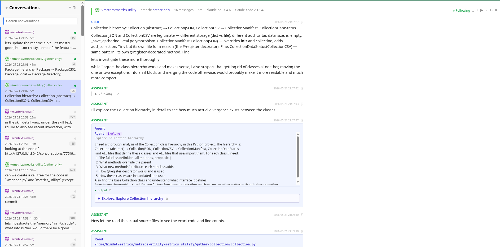
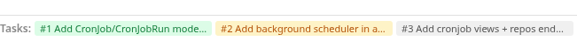

# context

Vibe-coded tool to browse coding-agent data in a web UI.

Reads `~/.claude/` and exposes conversation history, plans, skills, and memory
in a searchable, markdown-rendered interface with support for resuming, forking,
and starting new sessions.

Conversations can come from more than one agent — Claude Code and
[opencode](https://opencode.ai) today — mixed into a single list, grouped by
directory and sorted by date. Everything else is Claude-only.

(DO NOT expect this to be safe, secure, or complete)

## Features

### Conversations

- Conversations from Claude Code and opencode in one list, tagged by source
- Full-text search with SQLite-backed index
- Markdown rendering with syntax highlighting, Mermaid diagrams
- Rich code blocks: LaTeX, Graphviz, Vega-Lite, GeoJSON, ABC notation (with audio), Markmap, PlantUML
- Diagrams download as SVG or PNG from the block toolbar
- Tool use, thinking, subagent, and workflow blocks with inline results
- Edit blocks rendered as diffs, skill invocations collapsed under prompt
- Subagents expand inline where they ran, and are also listed under their parent
  in the sidebar so they can be opened on their own
- Resume, fork, or start new sessions from the UI
- Live session dock: queue prompts, answer tool/permission prompts inline,
  open an attached terminal, and see live idle/busy/waiting status
- Active session indicator, full task history with the current snapshot highlighted,
  and running agents
- Deleted logs stay visible from DB cache, live tailing for active sessions
- Estimated cost per conversation (list + detail), computed from transcript token
  usage for Claude and read from the harness for other agents

### Plans

- Grouped by repo, linked back to originating conversation
- Full markdown rendering with Execute button to launch a new session

### Skills

- Browse commands, skills, and saved workflows
- Create, edit, and delete with frontmatter metadata and syntax highlighting
- Open in $EDITOR, run with repo chooser, recent invocations

### Memory

- Browse, edit, and delete persistent memory items ($EDITOR support)
- MEMORY.md index with navigable links, linked to originating conversations

### Repos

- Browse CLAUDE.md files per repo (parent dirs, root, subdirs, global)
- Expandable inline preview with metadata, open in $EDITOR
- Git status: current branch, dirty files, remote tracking, ahead/behind
- Local branches with PR links, Jira issue detection, commit dates
- Worktrees listing with dirty state, terminal button, conversation links
- Fetch & Refresh, PR state lookup, branch cleanup (bulk + per-branch)
- Stale/missing repos grayed out, sorted by recent activity

### Cronjobs

- Schedule skills to run on cron with per-repo targeting
- Next run preview, manual "Run Now", run history with conversation links
- Runs execute headless in tmux, paired to a conversation, with a
  notification to open the live terminal
- Pairing resolves in the background, so a run links to its conversation while
  it is still live and the link survives an app restart
- Create cronjobs directly from a skill's detail page

### Git & forge integration

- GitHub, GitLab, and Gitea/Codeberg support
- PR/MR detection for current branch, autolinks for issues and Jira references
- Clickable commit SHAs, deterministic repo icon + color tint

### Activity & Costs

- Activity heatmap and usage line chart with layered running averages
- Per-day message counts and estimated cost in tooltips, filterable by repo
- Costs tab: estimated cost per repo with proportional bars and a running total
- Cost estimates are self-contained (derived from token usage in the transcripts)
- Each conversation is charged its own spend, so totals never count a subagent
  twice; a conversation's own header shows the rollup including its subagents

### Home screen

- Conversations grouped by repo with active/recent sections
- Tabs for Conversations, Plans, Skills, Cronjobs, Memory, Repos, Activity, Costs
- New session launcher, SPA with direct URL routing

## Screenshots



| Home                        | Skill                        |
| --------------------------- | ---------------------------- |
|  |  |

| Plan                        | Memory                        |
| --------------------------- | ----------------------------- |
|  |  |



## Dependencies

Python packages are managed by `uv` (see `pyproject.toml`). The app also shells
out to a few external tools:

- **Required:** `git`, and the `claude` CLI (configurable via `CLAUDE_CMD`).
- **Optional:** the `opencode` CLI (`OPENCODE_CMD`), needed only to launch,
  resume or fork opencode sessions. Reading its conversations needs nothing but
  the database. A bare name is resolved against `PATH` and the usual per-user
  install dirs, `~/.opencode/bin` included; set an absolute path if yours is
  somewhere else.
- **Default, with fallback:** `tmux` — sessions run inside a headless tmux
  session by default (enabling naming, reuse, and reliable conversation
  pairing). If `tmux` is absent the app falls back to launching a terminal
  directly. On macOS install it with `brew install tmux`.
- **Optional:** a terminal emulator for the *viewer* window (Linux: `$TERMINAL`,
  else the first known one on `PATH` - Ptyxis, ghostty, kitty, foot, GNOME
  Terminal, konsole, urxvt, xterm and friends; macOS: Terminal.app or iTerm via
  `osascript`) and a notifier (`notify-send` on Linux, `osascript` on macOS).
  Each terminal is launched with the flag it wants for a command, since they
  disagree; see `TERMINAL_EXEC` in `contexts/capabilities.py`.
- **Optional:** `systemctl --user`, used for persistent cronjob timers when the
  user systemd manager is available. Jobs can explicitly use either systemd or
  the in-process scheduler. Systemd-backed jobs run `%h/bin/wait-for-network`
  before the worker so persistent wake-up runs wait for ordinary network/DNS
  readiness; this check deliberately does not wait for a VPN. Timer workers
  retain the user-manager PATH and environment so tmux, agent wrappers, and
  agent credentials work the same way as interactive launches.
- **Optional:** `gh`, used for GitHub pull-request lookup. Without it, repository
  and branch links still work, but PR metadata is unavailable.

These are autodetected per platform at startup; override any of them in
`contexts/settings_local.py` (see `contexts/settings.py` for the full list).

### Other coding agents

Conversations can come from more than just Claude Code. List the ones you want in
`HARNESSES`, and they share a single list, grouped by directory and sorted by date
(this is not the work/personal split — that is `CONTEXTS_INSTANCE`):

```python
HARNESSES = ["claude", "opencode"]
```

- **Optional:** [opencode](https://opencode.ai). Its conversations live in a SQLite
  database at `~/.local/share/opencode/opencode.db` (`OPENCODE_DB`), read strictly
  read-only and safe to read while opencode is running. If it is missing, the
  harness is skipped silently.

For exact branch and PR metadata after the checkout moves on, optionally register
`contrib/opencode/repo-context.js` as a global opencode plugin. The companion plugin
injects repository context into new prompts and writes one metadata record per session
under `~/.cache/opencode-contexts/`; contexts reads those records read-only. It refreshes
at session creation and idle, before a new prompt, and after VCS or PR commands.
Refreshes are timestamped in `~/.cache/opencode-contexts/refresh.log` for tuning.
Register it in the global `opencode.json` plugin array, using an absolute `file://` URL
for the checkout path.

Sessions can be launched, resumed and forked for any harness that knows how, with
the same buttons — the conversation's own agent is the one that starts, never a
hardcoded one.

Sessions you start in a terminal show up too, if you launch them inside a tmux
session named the way contexts names its own — `ctx-<dir>-<hash>`, plus the
harness key for anything but Claude. A small shell wrapper that re-execs the real
binary under `tmux new-session -s <that name>` is the whole integration; contexts
adopts anything matching and leaves everything else alone.

Adding another agent means writing one adapter; see `docs/HARNESSES.md`.

On macOS the viewer window is opened by driving Terminal.app or iTerm via
`osascript`. The first time this happens macOS shows an Automation permission
prompt ("… wants to control iTerm"); allow it once and it is remembered.

### Shift+Enter in tmux

Because Claude sessions run inside tmux by default, Shift+Enter (insert a
newline in the prompt) stops working unless tmux passes modified keys through.
Add to `~/.tmux.conf`:

```tmux
set -s extended-keys on
set -as terminal-features 'xterm*:extkeys'
```

`extended-keys` is a server option, so restart the tmux server (`tmux
kill-server`, or just start a fresh session) for it to take effect. If your
terminal still swallows it, try `set -s extended-keys always`, or use the
built-in fallbacks: `\` at end of line then Enter, or Option/Meta+Enter.

## Usage

```
git clone https://github.com/himdel/ai-context
cd ai-context
make migrate # local sqlite file
make
```

```
open http://localhost:8062
```

### Remote access

`make run` listens on 127.0.0.1 only. To reach contexts from other machines,
set the bind address in `contexts/settings_local.py`:

```python
BIND = "0.0.0.0"
```

This also turns off Django's Host header check, so any hostname works, unless
you set `ALLOWED_HOSTS` there yourself. There is no authentication, and anyone
who can reach the port can launch agents that run commands as you - only do
this on a network you trust. Sessions launched remotely still open their
terminal viewer on the server's display; set `TERMINAL_VIEWER = False` if
nobody is sitting there.

The terminal emulator, X display, tmux usage, and notifier are autodetected.
Override them in `contexts/settings_local.py` if needed; see
`contexts/settings.py` for all available settings.

### Database migrations

After pulling changes that alter the models (or when the server complains about
unapplied migrations), run `make migrate` to bring the local SQLite database up
to date. For extra instances, use `make migrate-<name>` (e.g. `make migrate-personal`).

When you change anything in `api/models.py`, generate a migration and apply it:

```
uv run python manage.py makemigrations
make migrate
```

The DB doubles as a cache of parsed transcripts; run `make reindex` to force a
lazy re-parse if a new field needs backfilling from the logs.

### Multiple instances

To run a second instance with a different Claude home directory (e.g. personal
vs. work), create `contexts/settings_local_<name>.py` with your overrides:

```python
# contexts/settings_local_personal.py
from pathlib import Path

CLAUDE_DIR = Path.home() / ".claude-personal"
AUTOLINKS = []
```

Then run it alongside the default instance:

```
make migrate-personal   # creates db_personal.sqlite3
make run-personal       # runs on port 8063
```

The default `make run` is unchanged (port 8062, `settings_local.py`).

You can override the port with `PORT=8064 make run-personal`, or use the env
vars directly: `CONTEXTS_INSTANCE=personal PORT=8064 make run`.

Each instance gets its own database (`db_<name>.sqlite3`) and loads its own
settings file (`contexts/settings_local_<name>.py`). Both `settings_local*.py`
files and `db_*.sqlite3` are gitignored.
