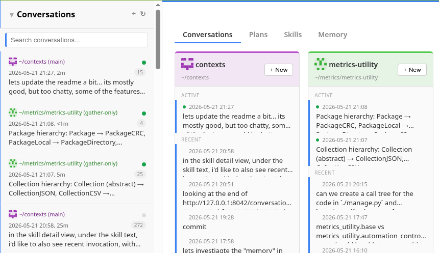
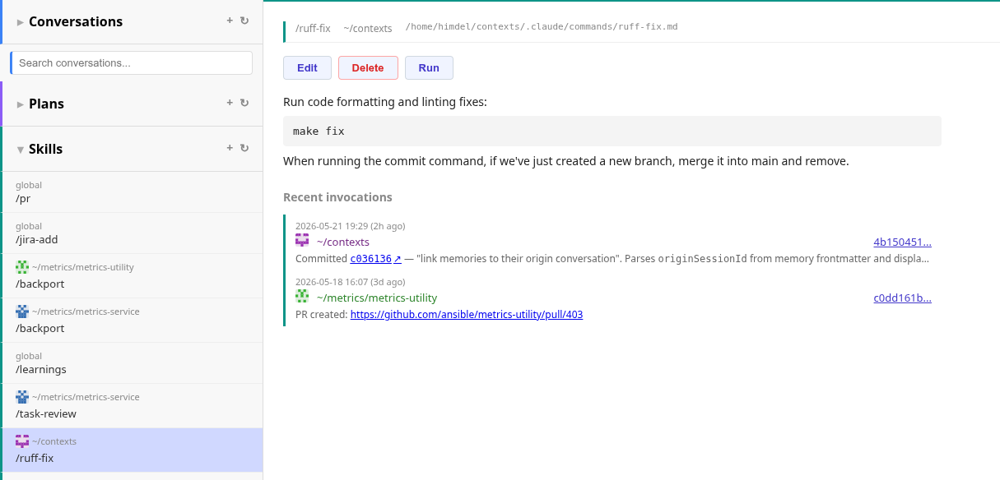
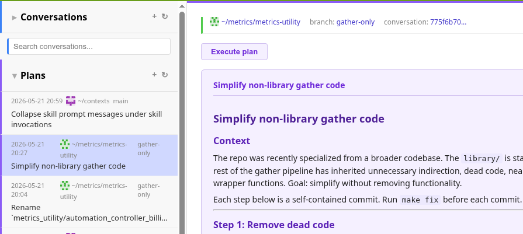
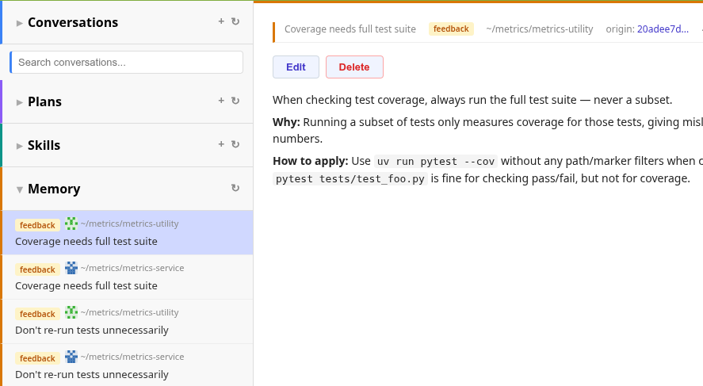

# context

Vibe-coded tool to browse Claude Code data in a web UI.

Reads `~/.claude/` and exposes conversation history, plans, skills, and memory
in a searchable, markdown-rendered interface with support for resuming, forking,
and starting new sessions.

(DO NOT expect this to be safe, secure, or complete)

## Features

### Conversations

- Full-text search with SQLite-backed index
- Markdown rendering with syntax highlighting, Mermaid diagrams
- Rich code blocks: LaTeX, Graphviz, Vega-Lite, GeoJSON, ABC notation (with audio), Markmap, PlantUML
- Tool use, thinking, subagent, and workflow blocks with inline results
- Edit blocks rendered as diffs, skill invocations collapsed under prompt
- Resume, fork, or start new sessions from the UI
- Active session indicator, status bar with running tasks and agents
- Deleted logs stay visible from DB cache, live tailing for active sessions
- Estimated cost per conversation (list + detail), computed from transcript token usage

### Plans

- Grouped by repo, linked back to originating conversation
- Full markdown rendering with Execute button to launch a new session

### Skills

- Browse commands, skills, and saved workflows
- Create, edit, and delete with frontmatter metadata and syntax highlighting
- Open in $EDITOR, run with repo chooser, recent invocations

### Memory

- Browse, edit, and delete persistent memory items ($EDITOR support)
- MEMORY.md index with navigable links, linked to originating conversations

### Repos

- Browse CLAUDE.md files per repo (parent dirs, root, subdirs, global)
- Expandable inline preview with metadata, open in $EDITOR
- Git status: current branch, dirty files, remote tracking, ahead/behind
- Local branches with PR links, Jira issue detection, commit dates
- Worktrees listing with dirty state, terminal button, conversation links
- Fetch & Refresh, PR state lookup, branch cleanup (bulk + per-branch)
- Stale/missing repos grayed out, sorted by recent activity

### Cronjobs

- Schedule skills to run on cron with per-repo targeting
- Next run preview, manual "Run Now", run history with conversation links
- Create cronjobs directly from a skill's detail page

### Git & forge integration

- GitHub, GitLab, and Gitea/Codeberg support
- PR/MR detection for current branch, autolinks for issues and Jira references
- Clickable commit SHAs, deterministic repo icon + color tint

### Activity & Costs

- Activity heatmap and usage line chart with layered running averages
- Per-day message counts and estimated cost in tooltips, filterable by repo
- Costs tab: estimated cost per repo with proportional bars and a running total
- Cost estimates are self-contained (derived from token usage in the transcripts)

### Home screen

- Conversations grouped by repo with active/recent sections
- Tabs for Conversations, Plans, Skills, Cronjobs, Memory, Repos, Activity, Costs
- New session launcher, SPA with direct URL routing

## Screenshots


| Home                        | Skill                        |
| --------------------------- | ---------------------------- |
|  |  |

| Plan                        | Memory                        |
| --------------------------- | ----------------------------- |
|  |  |


## Dependencies

Python packages are managed by `uv` (see `pyproject.toml`). The app also shells
out to a few external tools:

- **Required:** `git`, and the `claude` CLI (configurable via `CLAUDE_CMD`).
- **Default, with fallback:** `tmux` — Claude sessions run inside a headless
  tmux session by default (enabling naming, reuse, and reliable
  conversation pairing). If `tmux` is absent the app falls back to launching a
  terminal directly. On macOS install it with `brew install tmux`.
- **Optional:** a terminal emulator for the *viewer* window (Linux: `$TERMINAL`,
  else `rxvt-unicode`/`xterm`; macOS: Terminal.app or iTerm via `osascript`) and
  a notifier (`notify-send` on Linux, `osascript` on macOS).

These are autodetected per platform at startup; override any of them in
`contexts/settings_local.py` (see `contexts/settings.py` for the full list).

## Usage

```
git clone https://github.com/himdel/ai-context
cd ai-context
make migrate # local sqlite file
make
```

```
open http://localhost:8062
```

The terminal emulator, X display, tmux usage, and notifier are autodetected.
Override them in `contexts/settings_local.py` if needed; see
`contexts/settings.py` for all available settings.

### Database migrations

After pulling changes that alter the models (or when the server complains about
unapplied migrations), run `make migrate` to bring the local SQLite database up
to date. For extra instances, use `make migrate-<name>` (e.g. `make migrate-personal`).

When you change anything in `api/models.py`, generate a migration and apply it:

```
uv run python manage.py makemigrations
make migrate
```

The DB doubles as a cache of parsed transcripts; run `make reindex` to force a
lazy re-parse if a new field needs backfilling from the logs.

### Multiple instances

To run a second instance with a different Claude home directory (e.g. personal
vs. work), create `contexts/settings_local_<name>.py` with your overrides:

```python
# contexts/settings_local_personal.py
from pathlib import Path

CLAUDE_DIR = Path.home() / ".claude-personal"
AUTOLINKS = []
```

Then run it alongside the default instance:

```
make migrate-personal   # creates db_personal.sqlite3
make run-personal       # runs on port 8063
```

The default `make run` is unchanged (port 8062, `settings_local.py`).

You can override the port with `PORT=8064 make run-personal`, or use the env
vars directly: `CONTEXTS_INSTANCE=personal PORT=8064 make run`.

Each instance gets its own database (`db_<name>.sqlite3`) and loads its own
settings file (`contexts/settings_local_<name>.py`). Both `settings_local*.py`
files and `db_*.sqlite3` are gitignored.
